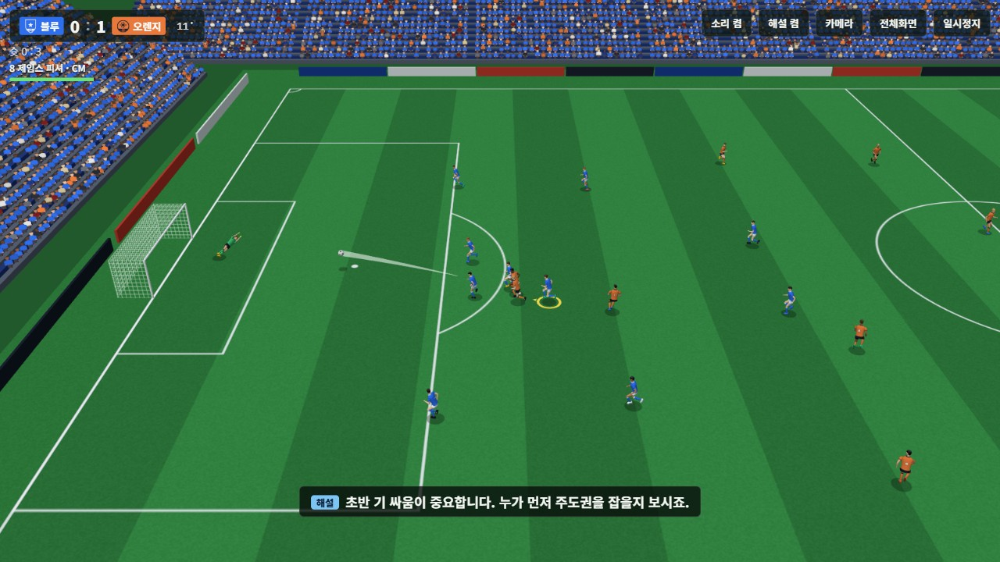
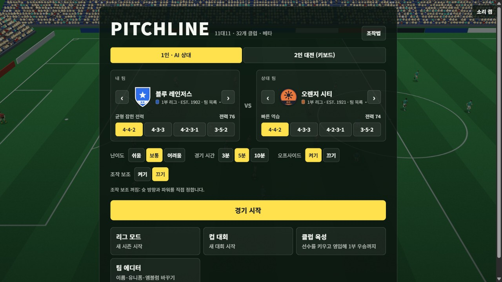
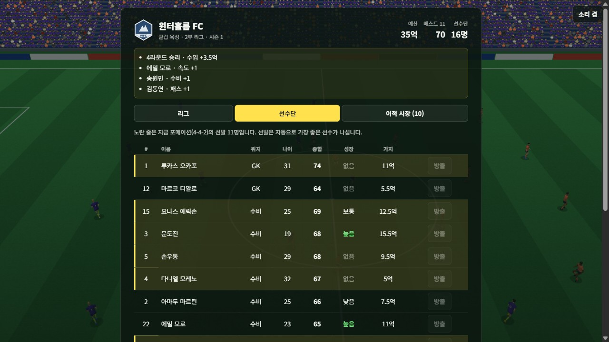
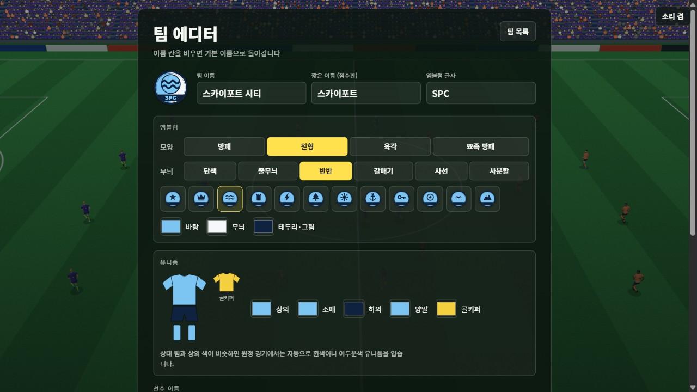

<div align="center">

# ⚽ PITCHLINE

### 브라우저에서 바로 하는 11 대 11 축구 게임

설치 없이, 링크 하나로. PC와 휴대폰 어디서나.

<br>

## [▶ 지금 플레이하기](https://yang-soccer.vercel.app)

**https://yang-soccer.vercel.app**

<br>


<br>



</div>

<br>

## 🏟️ 어떤 게임인가요

가상의 리그에서 32개 클럽이 맞붙는 3D 축구 게임입니다. 선수, 구단, 엠블럼은 모두 이 게임을 위해 만든 것이고, 공 물리와 선수 AI, 선수 동작, 효과음, 관중 소리까지 전부 코드로 만들어집니다. 그래서 게임 전체가 1.3MB짜리 파일 하나입니다.

<br>

## 🎮 게임 모드

| | 모드 | 설명 |
|:-:|---|---|
| ⚡ | **빠른 경기** | 팀과 포메이션을 고르고 바로 한 판. 키보드 2인 대전도 됩니다. |
| 🏆 | **리그** | 1부와 2부, 각 16개 클럽. 시즌이 끝나면 3팀씩 승격·강등됩니다. |
| 🥇 | **컵 대회** | 32강 토너먼트. 비기면 골든골 연장전, 그래도 안 끝나면 승부차기. |
| 📈 | **클럽 육성** | 여러 시즌 동안 선수를 키우고, 번 돈으로 영입해서 2부 팀을 1부 우승팀으로. |
| 🎨 | **팀 에디터** | 팀 이름, 선수 이름, 유니폼 색, 엠블럼을 내 마음대로. |

<br>

<div align="center">

| 메인 메뉴 | 클럽 육성 | 팀 에디터 |
|:-:|:-:|:-:|
|  |  |  |

</div>

<br>

## ✨ 특징

- **진짜 11 대 11** — 4가지 포메이션, 오프사이드, 파울과 카드, 프리킥 수비벽, 페널티킥, 코너킥, 선수 교체와 체력
- **살아 있는 선수들** — 공 없는 선수도 빈 공간으로 뛰고, 수비는 상대를 따라붙고, 공격수는 수비 뒤를 노립니다
- **발에 맞는 공** — 드리블 터치는 걸음에 맞춰, 킥은 발이 닿는 순간에. 측정 도구로 직접 재 가며 맞췄습니다
- **2인 중계** — 빠르게 외치는 캐스터와 한마디 거드는 해설위원이 한국어로 중계합니다. 골이 들어가면 소리칩니다
- **자라는 선수단** — 어린 선수는 뛸수록 성장하고, 노장은 기량이 떨어지다 은퇴합니다
- **자동 저장** — 리그, 컵, 육성, 에디터 내용은 기기에 저장되어 언제든 이어서 할 수 있습니다

<br>

## 🕹️ 조작법

### 키보드

| 동작 | 키 |
|---|---|
| 이동 | `W` `A` `S` `D` |
| 달리기 | `Shift` |
| 선수 전환 | `Space` |
| 패스 / 압박 | `J` |
| 슛 / 태클 | `K` (길게 누르면 세게) |
| 스루패스 | `L` |
| 로빙 패스 | `I` |
| 카메라 · 해설 · 소리 | `Z` · `C` · `M` |
| 일시정지 | `Esc` |

### 게임패드

왼쪽 스틱으로 이동 · `A` 패스 · `B` 슛 · `Y` 스루패스 · `X` 로빙 · `RB`/`RT` 달리기 · `LB` 선수 전환

### 휴대폰

화면을 **가로**로 돌린 뒤, 왼쪽을 누른 채 움직이면 이동하고 오른쪽 버튼으로 슛·패스·스루·로빙·달리기·전환을 합니다.

> 💡 선수를 전환하면 스틱을 움직이기 전까지 그 선수가 스스로 공을 쫓아갑니다.
> 메뉴에서 **조작 보조**를 켜면 슛이 골대 구석으로 향합니다.

<br>

## 🗺️ 로드맵

- [x] **M0–M2** 공 물리, 드리블·패스·슛, 11 대 11 정식 경기
- [x] **M3** 모바일 터치 조작
- [x] **M4** 32개 클럽, 리그, 컵, 클럽 육성, 에디터, 중계
- [ ] **M5** 웹 공개와 테스트 ← **지금 여기**
- [ ] **U1** Unity로 다시 만드는 PC 버전

자세한 내용은 [기획서](docs/game-design.html)에 있습니다.

<br>

## 🛠️ 직접 실행해 보기

Node.js가 필요합니다.

```bash
cd web
npm install
npm run dev      # 개발 서버 (http://localhost:5173)
npm run check    # 브라우저 없이 경기 시뮬레이션 검사
npm run build    # 배포용 빌드 (dist/index.html 파일 하나)
```

| 폴더 | 내용 |
|---|---|
| `web/src/sim` | 경기 규칙, 공 물리, 선수 AI, 리그·컵·육성 (화면과 무관한 순수 로직) |
| `web/src/render` | Three.js 화면, 선수 모델과 동작 |
| `web/src/ui` | 메뉴, 점수판, 각 모드 화면 |
| `web/src/audio` | 효과음, 관중 소리, 중계 |
| `web/dev` | 동작 확인용 개발 페이지 |
| `docs` | 기획서, 스크린샷 |

`main` 브랜치에 올라가면 자동으로 공개 사이트에 배포됩니다.

<br>

## 📝 알려 주세요

아직 베타입니다. 이상한 점을 발견하면 게임 메뉴의 **조작법 → 기기 정보 복사**로 복사한 내용과 함께 [이슈](https://github.com/jihunyangAI/Yang-soccer/issues)에 남겨 주세요.

<br>

<div align="center">

**[▶ 플레이하러 가기](https://yang-soccer.vercel.app)**

<sub>등장하는 모든 구단과 선수는 가상이며, 실제 구단·선수와 관계가 없습니다.</sub>

</div>
